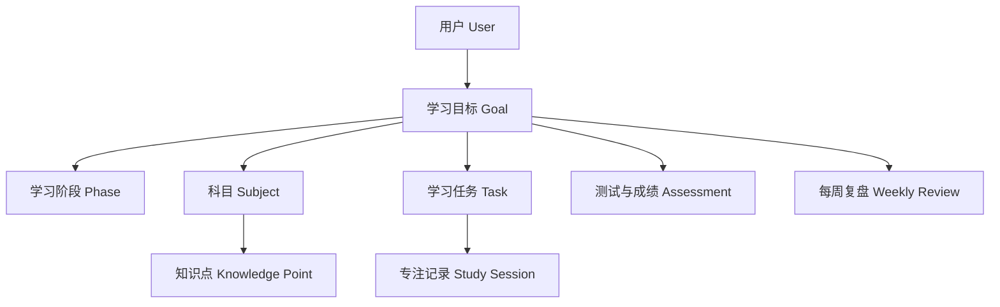
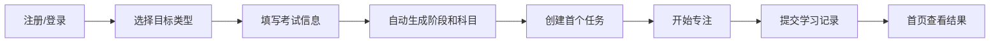
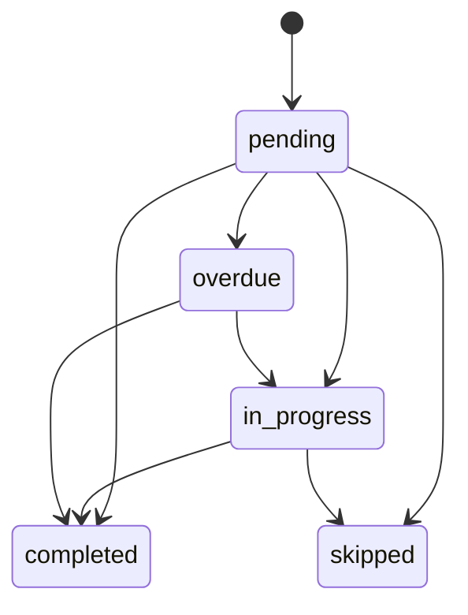
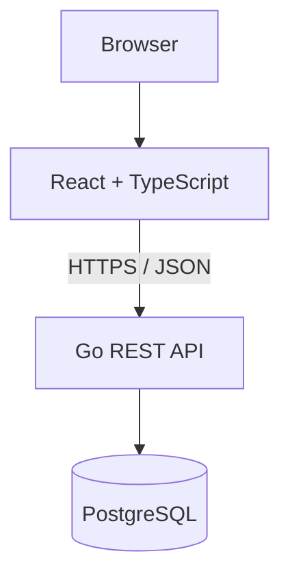

# 学迹 StudyTrack 产品原型

> 版本：V1.0 MVP
> 产品形态：响应式 Web 应用
> 技术实现：Go REST API + React + TypeScript + PostgreSQL

## 1. 产品概述

学迹 StudyTrack 是一套面向长期考试与阶段性复习的个人学习追踪系统，覆盖以下三种主要场景：

- 学位课程复习
- 考研复习
- 雅思备考

产品围绕完整学习闭环设计：

```text
学习目标 → 阶段计划 → 每日任务 → 专注记录 → 测试成绩 → 学习复盘 → 调整计划
```

系统不只记录“学了多久”，还同时追踪任务完成率、知识点掌握程度、练习与模考成绩、薄弱项和复习节奏。

---

## 2. 产品目标

### 2.1 核心目标

1. 让用户每天清楚知道当前最重要的学习任务。
2. 让长期目标可以被拆解为阶段、科目、知识点和每日任务。
3. 同时衡量学习投入与学习效果。
4. 通过数据分析和每周复盘帮助用户及时调整计划。
5. 使用统一模型支持学位复习、考研和雅思，不重复建设三套系统。

### 2.2 MVP 成功标准

用户可以完成以下闭环：

1. 注册并登录。
2. 创建一个学习目标。
3. 系统自动生成默认阶段与科目。
4. 新建并完成学习任务。
5. 使用专注计时记录实际学习过程。
6. 更新知识点掌握程度。
7. 录入一次练习或模考成绩。
8. 在首页和分析页看到学习结果。
9. 完成一份每周复盘。

---

## 3. 用户角色

MVP 只包含一种角色：个人学习者。

典型用户包括：

| 用户类型 | 主要需求 |
|---|---|
| 大学生 | 管理课程章节、期末考试与目标成绩 |
| 考研学生 | 管理院校目标、科目、复习轮次、真题与模考 |
| 雅思考生 | 管理听说读写、词汇、单项成绩与考试日期 |

后续版本可以增加教师、辅导员、班级管理员和机构管理员等角色。

---

## 4. 核心信息模型



统一层级关系：

```text
学习目标 Goal
├── 学习阶段 Phase
├── 科目 Subject
│   └── 知识点 Knowledge Point
├── 学习任务 Task
│   └── 专注记录 Study Session
├── 测试与成绩 Assessment
└── 每周复盘 Weekly Review
```

---

## 5. 信息架构

### 5.1 主导航

```text
首页
我的目标
今日任务
学习计划
专注学习
知识点
模考与成绩
数据分析
每周复盘
系统设置
```

### 5.2 前端页面路由

| 页面 | 路由 | 作用 |
|---|---|---|
| 登录/注册 | `/login` | 用户认证 |
| 首页 | `/dashboard` | 今日任务、倒计时与核心统计 |
| 我的目标 | `/goals` | 创建和管理学习目标 |
| 目标详情 | `/goals/:goalId` | 查看目标、阶段、科目与总体进度 |
| 今日任务 | `/tasks` | 创建、筛选和更新任务 |
| 学习计划 | `/plans` | 查看周计划与阶段安排 |
| 专注学习 | `/focus` | 计时并提交学习记录 |
| 知识点 | `/knowledge` | 管理知识点和复习状态 |
| 模考与成绩 | `/assessments` | 录入练习、模考与正式成绩 |
| 数据分析 | `/analytics` | 查看学习投入和效果趋势 |
| 每周复盘 | `/reviews` | 创建和查看周期复盘 |
| 系统设置 | `/settings` | 修改个人信息和时区 |

---

## 6. 核心用户流程

### 6.1 首次使用流程



### 6.2 日常学习流程

```text
进入首页
→ 查看今日任务与逾期任务
→ 选择任务并开始专注
→ 完成后填写专注度和掌握度
→ 必要时更新关联知识点
→ 查看今日完成率和学习时长
```

### 6.3 周期复盘流程

```text
查看本周学习数据
→ 对比计划时间与实际时间
→ 识别薄弱科目和知识点
→ 填写问题与总结
→ 设置下周重点
→ 调整后续任务
```

---

## 7. 页面原型

## 7.1 登录与注册

### 页面目标

让用户通过邮箱快速创建账户或登录系统。

### 线框图

```text
┌──────────────────────────────────────────┐
│              学迹 StudyTrack             │
│     让每一次学习都留下清晰的进度          │
│                                          │
│  [登录] [注册]                            │
│                                          │
│  邮箱       [________________________]   │
│  密码       [________________________]   │
│  昵称       [________________________]   │
│                                          │
│              [进入学习系统]              │
└──────────────────────────────────────────┘
```

### 字段规则

- 邮箱必填且格式合法。
- 密码必填。
- 注册时昵称可选。
- 登录成功后保存访问令牌并跳转首页。
- 访问受保护页面时，无有效登录态自动跳转登录页。

---

## 7.2 首页 Dashboard

### 页面目标

首页优先回答一个问题：**今天应该学什么？**

### 线框图

```text
┌──────────────────────────────────────────────────────────────┐
│ 学迹 StudyTrack                             用户菜单 / 退出   │
├──────────────┬───────────────────────────────────────────────┤
│ 首页         │  学习概览                                    │
│ 我的目标     │  今日 135 分钟  本周 860 分钟  连续 12 天    │
│ 今日任务     ├───────────────────────────────────────────────┤
│ 学习计划     │  活跃目标与考试倒计时                         │
│ 专注学习     │  考研：128 天   雅思：45 天                  │
│ 知识点       ├───────────────────────────────────────────────┤
│ 模考与成绩   │  今日任务                                     │
│ 数据分析     │  □ 高数极限练习          45 分钟             │
│ 每周复盘     │  □ 雅思听力 Section 3     30 分钟             │
│ 设置         │  ☑ 背诵英语单词           25 分钟             │
│              ├───────────────────────────────────────────────┤
│              │  本周趋势          科目进度                   │
│              │  ▁▃▅▂▆█▅          数学 72% 英语 61%          │
│              ├───────────────────────────────────────────────┤
│              │  薄弱知识点：概率论、雅思写作、进程同步       │
└──────────────┴───────────────────────────────────────────────┘
```

### 核心指标

- 今日学习时长
- 本周学习时长
- 今日任务完成数和总数
- 连续学习天数
- 逾期任务数
- 活跃目标及考试日期
- 科目进度
- 薄弱知识点
- 最近测试成绩
- 最近七天学习趋势

### 交互规则

- 点击任务可跳转任务页或专注页。
- 点击目标可进入目标详情。
- 点击薄弱知识点可进入知识点页。
- 无目标时展示创建目标引导。
- 无任务时展示新增今日任务引导。

---

## 7.3 我的目标

### 页面目标

创建和管理学位复习、考研、雅思三类目标。

### 目标卡片

```text
┌─────────────────────────────┐
│ 考研 2027              进行中│
│ 目标日期：2026-12-26         │
│ 总体进度：42%                │
│ ████████░░░░░░░░            │
│ 目标分数：390                │
│ [查看详情]                   │
└─────────────────────────────┘
```

### 创建目标表单

通用字段：

| 字段 | 类型 | 规则 |
|---|---|---|
| 目标名称 | 文本 | 必填 |
| 目标类型 | 枚举 | 学位、考研、雅思 |
| 开始日期 | 日期 | 必填 |
| 考试日期 | 日期 | 必填，不能早于开始日期 |
| 目标分数 | 数值 | 可选 |
| 扩展设置 | JSON 配置 | 根据目标类型动态填写 |

### 学位复习模板

扩展字段：

- 学期
- 课程列表
- 各课程目标成绩
- 每周可用学习时间

默认阶段：

```text
整理课程
基础复习
章节练习
模拟考试
考前冲刺
```

### 考研模板

扩展字段：

- 目标院校
- 目标专业
- 政治、英语、数学、专业课目标分数
- 每日可用学习时间

默认阶段：

```text
基础轮
强化轮
真题轮
冲刺轮
```

默认科目：

```text
政治
英语
数学
专业课
```

### 雅思模板

扩展字段：

- 当前总分
- 目标总分
- 听力、阅读、写作、口语目标分数
- 每日单词量

默认阶段：

```text
词汇基础
听力专项
阅读专项
写作专项
口语专项
整套模考
```

默认科目：

```text
听力
阅读
写作
口语
词汇
```

---

## 7.4 目标详情

### 页面目标

集中展示目标总体信息、阶段和科目进展。

### 线框图

```text
┌────────────────────────────────────────────────────┐
│ 考研 2027                         距考试 128 天     │
│ XX大学 · 计算机科学与技术                          │
│ 总进度 42%   目标分 390                            │
├────────────────────────────────────────────────────┤
│ 阶段                                               │
│ 基础轮 ✓  强化轮 ●  真题轮 ○  冲刺轮 ○            │
├────────────────────────────────────────────────────┤
│ 科目                                               │
│ 数学      72%      目标 120                        │
│ 英语      61%      目标 75                         │
│ 专业课    55%      目标 125                        │
│ 政治      32%      目标 70                         │
└────────────────────────────────────────────────────┘
```

### 进度规则

MVP 中目标进度主要由已完成任务与总任务比例聚合计算。科目进度可以结合任务完成情况和学习记录进行展示。

---

## 7.5 今日任务

### 页面目标

让用户快速新增、筛选和完成任务。

### 线框图

```text
┌─────────────────────────────────────────────────────┐
│ 今日任务                      [+ 新建任务]           │
│ [全部] [待开始] [进行中] [已完成] [已逾期]          │
├─────────────────────────────────────────────────────┤
│ □ 高数：极限练习              高优先级   45 分钟    │
│   考研 2027 / 数学 / 强化轮                         │
│   [开始专注] [编辑] [完成]                          │
├─────────────────────────────────────────────────────┤
│ ☑ 雅思词汇 80 个              已完成     25 分钟    │
└─────────────────────────────────────────────────────┘
```

### 任务字段

| 字段 | 说明 |
|---|---|
| 标题 | 必填 |
| 描述 | 可选 |
| 所属目标 | 必填 |
| 所属阶段 | 可选 |
| 所属科目 | 可选 |
| 关联知识点 | 可选 |
| 任务类型 | 阅读、练习、背诵、模考、复习等 |
| 计划日期 | 必填 |
| 预计时长 | 分钟 |
| 实际时长 | 由学习记录累计或手动更新 |
| 优先级 | 低、中、高 |
| 状态 | 待开始、进行中、已完成、已逾期、已跳过 |

### 状态流转



---

## 7.6 学习计划

### 页面目标

按周查看任务安排和各目标的学习节奏。

### 周计划原型

```text
┌──────────────────────────────────────────────────────────┐
│ 2026年8月3日—8月9日                                      │
├────────┬────────┬────────┬────────┬────────┬─────────────┤
│ 周一   │ 周二   │ 周三   │ 周四   │ 周五   │ 周末        │
│ 高数   │ 英语   │ 线代   │ 高数   │ 专业课 │ 模拟测试    │
│ 政治   │ 听力   │ 专业课 │ 阅读   │ 写作   │ 本周复盘    │
├────────┴────────┴────────┴────────┴────────┴─────────────┤
│ 本周计划 33 小时        已完成 24 小时                   │
└──────────────────────────────────────────────────────────┘
```

MVP 以周任务列表为主。拖拽排期、月历视图和自动重排可以在后续版本增加。

---

## 7.7 专注学习

### 页面目标

用尽量少的干扰记录一次真实学习过程。

### 线框图

```text
┌──────────────────────────────────────┐
│ 高等数学：极限与连续                 │
│                                      │
│               42:18                  │
│                                      │
│          [暂停]   [完成学习]         │
│                                      │
│ 今日累计：2小时35分钟                │
│ 当前任务预计：60分钟                 │
│                                      │
│ 临时笔记                             │
│ [_________________________________]  │
└──────────────────────────────────────┘
```

### 开始专注

用户选择：

- 学习目标
- 学习任务，可选
- 学习科目，可选

系统创建一条进行中的学习记录，并记录开始时间。

### 完成专注

用户填写：

| 字段 | 范围 |
|---|---|
| 实际时长 | 自动计算，允许修正 |
| 专注程度 | 1—5 |
| 掌握程度 | 1—5 |
| 学习笔记 | 可选 |

结束后：

- 更新学习记录。
- 将学习时长计入今日、本周和科目统计。
- 关联任务时，累计任务实际时长。
- 用户可继续在任务页完成任务状态。

---

## 7.8 知识点

### 页面目标

维护科目知识结构，识别薄弱项，并记录复习状态。

### 知识点树示例

```text
高等数学
├── 函数与极限
│   ├── 数列极限
│   ├── 函数极限
│   └── 无穷小
├── 导数与微分
└── 积分
```

### 知识点字段

| 字段 | 说明 |
|---|---|
| 名称 | 必填 |
| 所属科目 | 必填 |
| 父知识点 | 支持树形结构，可选 |
| 重要程度 | 普通、重点、核心 |
| 掌握度 | 0—100 |
| 复习状态 | 未学习、学习中、已掌握、需复习 |
| 下次复习时间 | 可选 |
| 复习次数 | 自动累计 |
| 错题数 | 手动或后续自动关联 |

### 掌握度建议

后续智能版本可使用以下加权逻辑：

```text
掌握度 =
主观掌握评分 × 20%
+ 练习正确率 × 35%
+ 模考表现 × 30%
+ 近期复习情况 × 15%
```

MVP 允许直接更新掌握度和复习状态，避免过早引入复杂算法。

---

## 7.9 模考与成绩

### 页面目标

记录练习、模拟考试、正式考试和雅思单项成绩。

### 通用字段

| 字段 | 说明 |
|---|---|
| 名称 | 必填 |
| 所属目标 | 必填 |
| 所属科目 | 可选 |
| 类型 | 练习、模考、正式考试、雅思 |
| 考试日期 | 必填 |
| 得分 | 数值 |
| 满分 | 数值 |
| 用时 | 分钟 |
| 详细信息 | JSON，可保存题型或单项分数 |

### 考研成绩示例

```text
考试名称：考研数学模拟卷 3
得分：108 / 150
用时：165 分钟
选择题：42 / 50
填空题：24 / 30
解答题：42 / 70
```

### 雅思成绩示例

```text
听力：7.0
阅读：7.5
写作：6.0
口语：6.5
总分：7.0
```

### 交互规则

- 列表按考试日期倒序展示。
- 分析页使用成绩记录生成趋势。
- 允许删除错误记录。
- `details` 用于适配不同考试类型的特殊字段。

---

## 7.10 数据分析

### 页面目标

同时衡量学习投入、执行情况和学习效果。

### 指标分组

#### 学习投入

- 总学习时长
- 每日学习时长
- 各科目学习时长
- 平均单次专注时长

#### 计划执行

- 已完成任务数
- 任务完成率
- 每日完成趋势
- 逾期任务数

#### 学习效果

- 科目进度
- 成绩趋势
- 知识点掌握度
- 薄弱知识点

#### 学习质量

- 平均专注评分
- 主观掌握评分
- 高效学习日期和科目

### 页面原型

```text
┌─────────────────────────────────────────────────────────┐
│ 总学习时长 286h  完成任务 248  完成率 82%  专注度 4.2 │
├──────────────────────────┬──────────────────────────────┤
│ 最近学习时长趋势         │ 任务完成趋势                 │
│ ▁▃▅▂▆█▅                  │ ▁▂▄▅▆▇█                     │
├──────────────────────────┼──────────────────────────────┤
│ 科目进度                 │ 成绩趋势                     │
│ 数学 72% 英语 61%       │ 92 → 101 → 108              │
├──────────────────────────┴──────────────────────────────┤
│ 薄弱知识点：概率论 42%、雅思写作 48%、政治 55%         │
└─────────────────────────────────────────────────────────┘
```

---

## 7.11 每周复盘

### 页面目标

把统计数据转化为下周可执行的调整。

### 复盘字段

| 字段 | 说明 |
|---|---|
| 所属目标 | 必填 |
| 周开始日期 | 必填 |
| 计划时长 | 分钟 |
| 实际时长 | 分钟 |
| 完成率 | 百分比 |
| 本周总结 | 自由文本 |
| 遇到的问题 | 自由文本 |
| 下周重点 | 自由文本 |

### 复盘模板

```text
本周计划学习：35 小时
实际学习：29 小时
任务完成率：82%

本周做得好的地方：
[_____________________________________]

本周遇到的问题：
[_____________________________________]

下周重点：
[_____________________________________]
```

后续版本可根据学习数据自动生成复盘草稿。

---

## 7.12 系统设置

### 页面目标

管理用户基础信息和显示时间规则。

字段：

- 邮箱，只读
- 昵称
- 时区

所有日期统计和任务日期应基于用户时区解释。

---

## 8. 响应式设计

### 桌面端

- 左侧固定导航。
- 右侧使用卡片和多列网格。
- 图表与列表可并排展示。

### 移动端

- 导航折叠为顶部或抽屉菜单。
- 多列卡片变为单列。
- 表格转为卡片列表。
- 主要操作按钮保持明显且易点击。
- 专注计时页面优先占据整个可视区域。

建议断点：

| 设备 | 宽度 |
|---|---|
| 手机 | `< 768px` |
| 平板 | `768px—1199px` |
| 桌面 | `>= 1200px` |

---

## 9. 状态与空页面

所有核心页面需要覆盖以下状态：

- 加载中
- 请求失败
- 无数据
- 表单提交中
- 操作成功
- 操作失败

空状态示例：

```text
还没有学习目标
创建一个学位、考研或雅思目标，系统会自动生成基础学习结构。
[创建第一个目标]
```

---

## 10. 数据模型

### users

```text
id
email
password_hash
nickname
timezone
created_at
updated_at
```

### goals

```text
id
user_id
name
type
start_date
exam_date
status
target_score
progress
settings
created_at
updated_at
```

目标类型：

```text
degree
postgraduate
ielts
```

### phases

```text
id
goal_id
name
start_date
end_date
sort_order
status
```

### subjects

```text
id
goal_id
name
category
target_score
current_score
planned_minutes
color
```

### knowledge_points

```text
id
subject_id
parent_id
name
importance
mastery
review_status
next_review_at
review_count
wrong_count
```

### tasks

```text
id
goal_id
phase_id
subject_id
knowledge_point_id
title
description
task_type
priority
status
planned_date
estimated_minutes
actual_minutes
completed_at
```

### study_sessions

```text
id
user_id
goal_id
task_id
subject_id
started_at
ended_at
duration_minutes
focus_score
mastery_score
notes
```

### assessments

```text
id
goal_id
subject_id
name
assessment_type
exam_date
score
full_score
duration_minutes
details
```

### weekly_reviews

```text
id
goal_id
week_start
planned_minutes
actual_minutes
completion_rate
summary
problems
next_week_focus
```

---

## 11. API 设计概要

统一前缀：

```text
/api/v1
```

### 认证与用户

```http
POST /auth/register
POST /auth/login
GET  /users/me
PUT  /users/me
```

### 首页

```http
GET /dashboard
```

### 学习目标

```http
GET    /goals
POST   /goals
GET    /goals/:id
PUT    /goals/:id
DELETE /goals/:id
```

### 阶段与科目

```http
GET  /goals/:id/phases
POST /goals/:id/phases
GET  /goals/:id/subjects
POST /goals/:id/subjects
PUT  /subjects/:id
```

### 学习任务

```http
GET    /tasks
POST   /tasks
PUT    /tasks/:id
PATCH  /tasks/:id/status
DELETE /tasks/:id
```

### 专注记录

```http
POST /study-sessions/start
POST /study-sessions/:id/finish
GET  /study-sessions
```

### 知识点

```http
GET  /subjects/:id/knowledge-points
POST /knowledge-points
PUT  /knowledge-points/:id
POST /knowledge-points/:id/review
```

### 模考与成绩

```http
GET    /goals/:id/assessments
POST   /assessments
PUT    /assessments/:id
DELETE /assessments/:id
```

### 每周复盘

```http
GET  /goals/:id/reviews
POST /weekly-reviews
```

### 数据分析

```http
GET /analytics/overview
```

完整请求和响应示例见 [`API.md`](API.md)。

---

## 12. 技术架构



### 前端

- React
- TypeScript
- Vite
- React Router
- TanStack Query
- Zustand
- 原生 CSS 响应式组件体系

### 后端

- Go
- 标准库 `net/http`
- pgx PostgreSQL 驱动
- JWT 鉴权
- bcrypt 密码哈希
- 模块化单体架构

### 部署

- Docker Compose
- Nginx 托管前端静态文件
- Go 服务提供 REST API
- PostgreSQL 持久化数据

---

## 13. 非功能需求

### 安全

- 密码必须以 bcrypt 哈希保存。
- 除注册、登录、健康检查外，业务接口需要 JWT。
- 用户只能访问自己的目标和关联数据。
- 生产环境必须使用 HTTPS 和高强度 JWT 密钥。

### 性能

- 首页聚合接口应一次返回主要数据，减少前端串行请求。
- 列表接口应支持日期或目标筛选。
- 数据量增长后为用户 ID、目标 ID、计划日期和考试日期增加索引。

### 可维护性

- 前后端类型和枚举保持一致。
- 业务数据按用户隔离。
- 数据库迁移保持幂等或使用版本化迁移。
- 三类学习目标共享基础模型，通过模板和扩展设置体现差异。

---

## 14. MVP 范围

### 已纳入

- 注册、登录和 JWT 鉴权
- 三类目标模板
- 阶段和默认科目自动生成
- 目标、任务、科目和阶段管理
- 专注学习记录
- 知识点管理和复习记录
- 练习、模考和考试成绩
- 首页聚合统计
- 数据分析
- 每周复盘
- 响应式布局
- Docker Compose 部署

### 暂不纳入

- 学习社区和好友排行榜
- 班级、教师和机构管理
- AI 自动批改
- AI 自动生成完整学习计划
- 完整艾宾浩斯算法
- 推送通知
- 移动端原生应用
- 离线同步
- 文件资料上传和云存储
- 实时协作

---

## 15. 验收用例

### 用例 1：创建考研目标

1. 用户注册并登录。
2. 选择“考研”。
3. 填写名称、日期、目标分数和院校信息。
4. 提交后目标创建成功。
5. 系统自动生成基础轮、强化轮、真题轮、冲刺轮。
6. 系统自动生成政治、英语、数学和专业课。

### 用例 2：完成一次专注学习

1. 用户创建“高数极限练习”任务。
2. 在专注页选择该任务并开始。
3. 完成后提交时长、专注评分和掌握评分。
4. 首页今日学习时长增加。
5. 任务实际时长更新。
6. 统计页出现当天学习数据。

### 用例 3：维护薄弱知识点

1. 用户在数学科目创建“概率论”知识点。
2. 设置掌握度为 42、状态为“需复习”。
3. 首页或分析页显示该薄弱知识点。
4. 用户完成复习后更新掌握度和下次复习时间。

### 用例 4：录入雅思成绩

1. 用户选择雅思目标。
2. 创建类型为“雅思”的成绩记录。
3. 填写总分和听说读写详细分数。
4. 记录出现在成绩列表。
5. 分析页成绩趋势同步更新。

### 用例 5：提交周复盘

1. 用户选择目标和周开始日期。
2. 填写计划时长、实际时长、总结、问题和下周重点。
3. 保存后出现在历史复盘列表。
4. 用户可根据复盘内容调整下一周任务。

---

## 16. 后续迭代方向

### V1.1

- 月历和拖拽排期
- 任务批量创建
- 错题本与知识点关联
- 自定义目标模板
- 数据导出

### V1.2

- 基于遗忘曲线的复习提醒
- 自动识别逾期风险
- 模考分数预测
- 学习时间智能分配
- 自动生成周复盘草稿

### V2.0

- AI 学习规划助手
- 教师与班级体系
- 多端同步
- 原生移动应用
- 学习资料与题库系统

---

## 17. 原型与源码对应关系

| 原型模块 | React 页面 | Go/API 模块 |
|---|---|---|
| 登录/注册 | `frontend/src/pages/LoginPage.tsx` | 认证与用户接口 |
| 首页 | `DashboardPage.tsx` | `/dashboard` |
| 我的目标 | `GoalsPage.tsx` | `/goals` |
| 目标详情 | `GoalDetailPage.tsx` | `/goals/:id`、阶段和科目接口 |
| 今日任务 | `TasksPage.tsx` | `/tasks` |
| 学习计划 | `PlansPage.tsx` | 任务与阶段查询 |
| 专注学习 | `FocusPage.tsx` | `/study-sessions` |
| 知识点 | `KnowledgePage.tsx` | `/knowledge-points` |
| 模考与成绩 | `AssessmentsPage.tsx` | `/assessments` |
| 数据分析 | `AnalyticsPage.tsx` | `/analytics/overview` |
| 每周复盘 | `ReviewsPage.tsx` | `/weekly-reviews` |
| 系统设置 | `SettingsPage.tsx` | `/users/me` |
